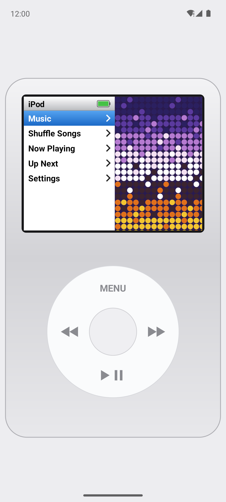
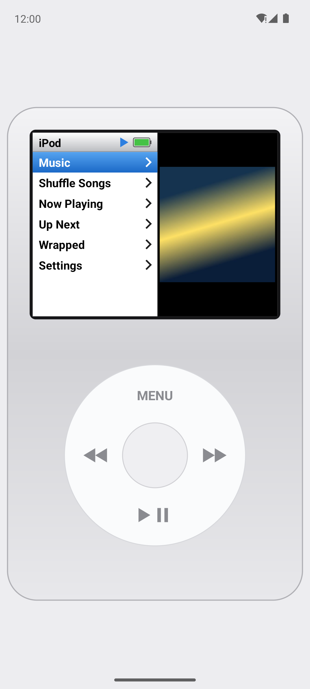
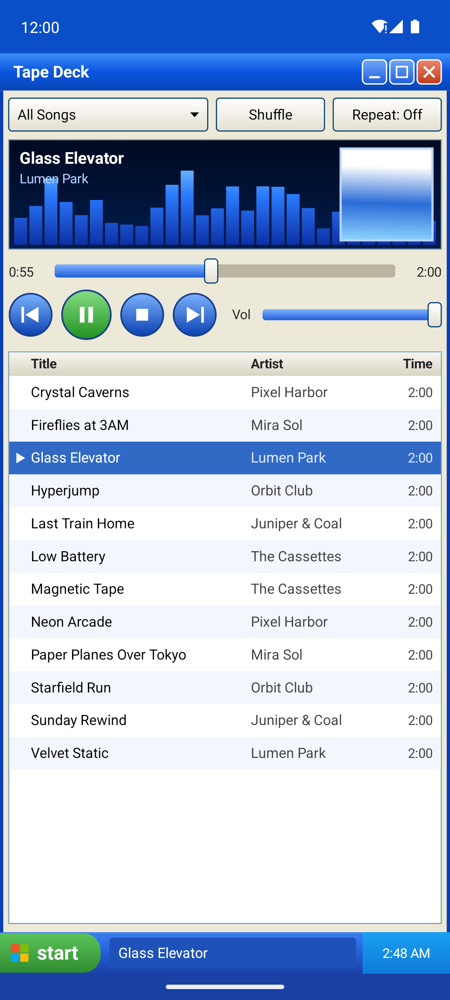
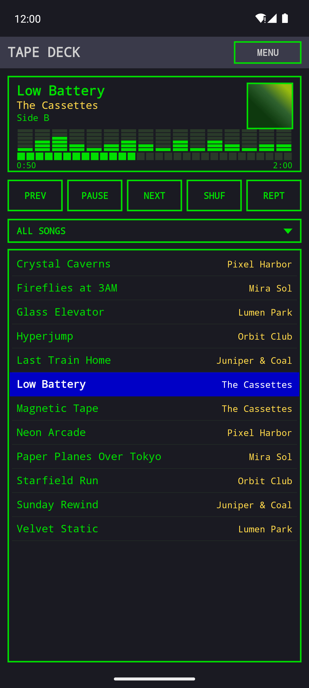
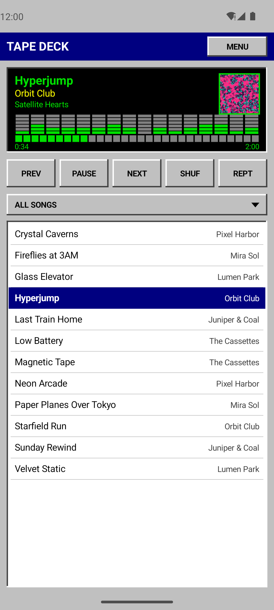
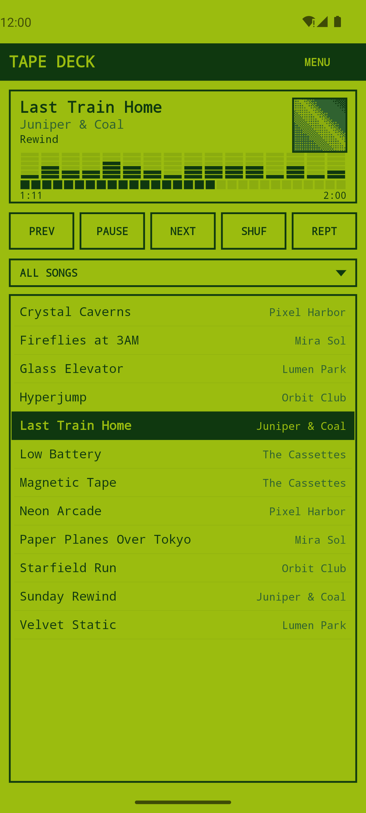
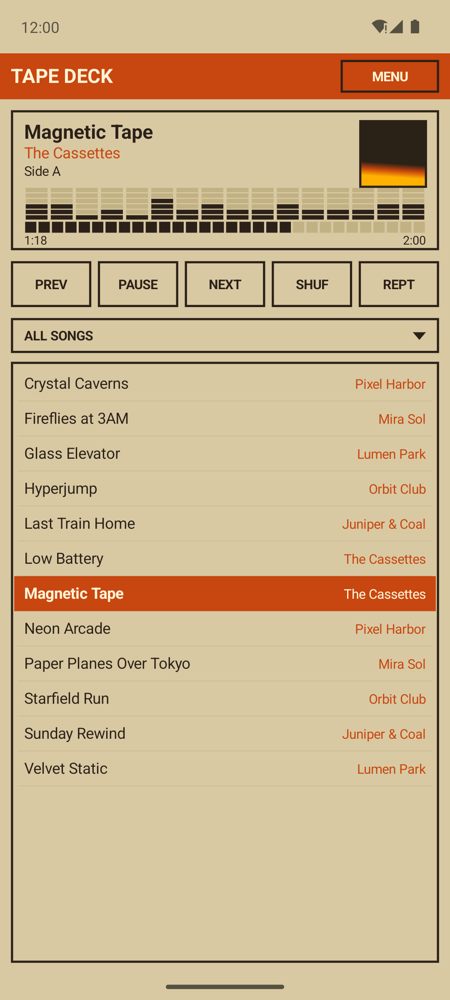
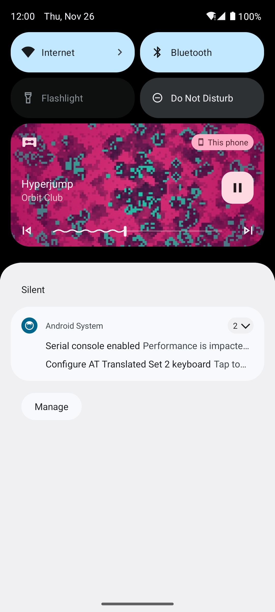
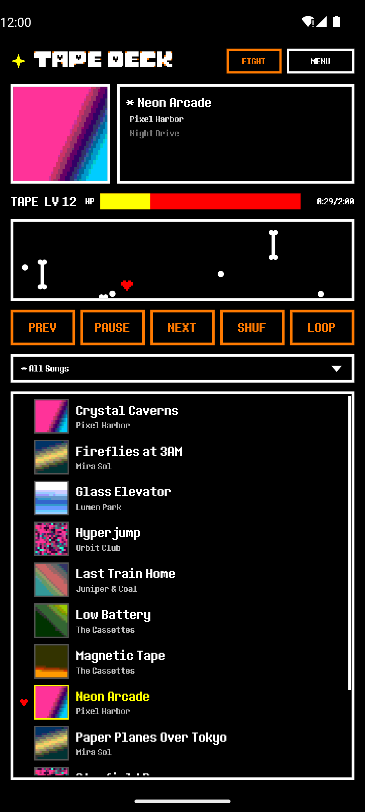
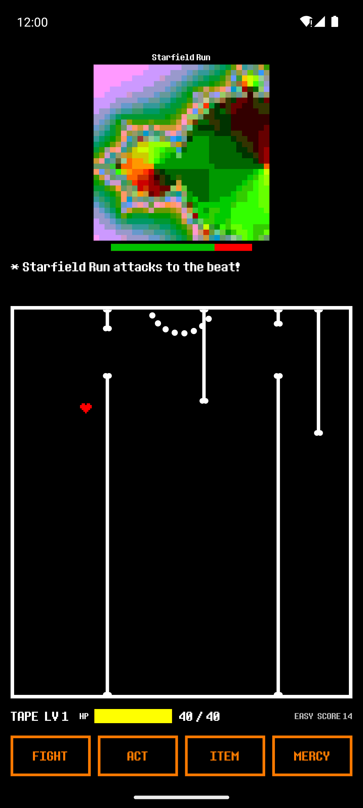

<h1 align="center">📼 Tape Deck</h1>

<p align="center"><b>A retro music player for Android.</b> Your own music files, dressed up as an iPod Classic, Windows XP, Winamp, a Game Boy, iTunes 2011, and more.<br>
Free, open source, no ads, no accounts, no internet needed.</p>

<p align="center">
  <a href="https://github.com/rxvy-dev/tapedeck/releases/latest/download/TapeDeck.apk"><b>⬇ Download the APK</b></a> ·
  <a href="https://github.com/rxvy-dev/tapedeck/releases">All releases</a> ·
  <a href="CHANGELOG.md">Changelog</a>
</p>

<p align="center">
  
  
  
  
</p>
<p align="center">
  
  
  
  
</p>

## Features

- **8 hand-drawn themes**: iPod Classic (working click wheel), Windows XP, Windows 95, Game Boy, Winamp, Cassette, iTunes 2011, and one secret.
- **Keeps playing in the background**: notification and lock-screen controls, headphone and Bluetooth buttons, pauses when you unplug headphones or get a call.
- **A shuffle that actually shuffles**: every song plays once before anything repeats.
- **Find anything**: search, artists, albums, favorites ♥, recently added, most played.
- **Queue**: *Play Next* and *Add to Queue* from any song (hold it), plus an *Up Next* list.
- **Sleep timer** (fades out gently, or stops when the song ends), **equalizer** presets, **playback speed**.
- **Picks up where you left off**: same queue, same song, same spot.
- Real album art everywhere (pixel-art versions in the pixel themes).
- Tiny APK, no trackers, no network permission at all.

## The secret theme

<details>
<summary>Spoilers</summary>

Play any song from **Undertale** or **Deltarune** and Tape Deck notices: *"You are filled with DETERMINATION."* That unlocks the `* ???` theme, which uses the bundled **Determination** font.

<p align="center">
  
  
</p>

- Tap **FIGHT**: the song becomes the enemy and **attacks on its own beats**. Tape Deck decodes the track and finds the kicks and snares, so bones, spears, rings of bullets and blasters land with the music, and the attack style changes every 16 beats.
- Drag anywhere to move your SOUL (it follows your finger's movement, so your thumb never covers it).
- Tap **FIGHT** right *on the beat* for PERFECT hits and combos. **ACT** checks the song's tempo, **ITEM** heals (3 per fight), **MERCY** spares it.
- Survive until the song ends to win, and the next song steps up.
- Outside the fight: drag the SOUL in the bullet board, tap the portrait for a full-screen poster, tap the art there to switch between pixel sprite and HD.
</details>

## Install

1. Download **[TapeDeck.apk](https://github.com/rxvy-dev/tapedeck/releases/latest/download/TapeDeck.apk)** on your phone.
2. Open it. If Android asks, allow your browser or file manager to *install unknown apps*.
3. Allow music access when Tape Deck asks.

Works on Android 5.0 and newer. Release APKs are signed with the same key as every earlier Tape Deck build, so they install over the old version.

## Build it yourself

| Where | How |
|---|---|
| **PC (Void / Auxo Linux)** | `./install.sh`: installs the Android SDK, builds, installs on your phone over USB |
| **PC (anything with the SDK)** | `./build.sh` → `TapeDeck.apk` |
| **On the phone (Termux from F-Droid)** | `bash termux-build.sh` |
| **GitHub Actions** | every push builds an APK artifact; a new version number in `AndroidManifest.xml` (or a `v*` tag) makes a Release |

No Gradle: it's plain Java against `android.jar`, built with `aapt2` + `d8` (or `dx`) + `apksigner` in about 10 seconds.

### Publishing a release

```bash
./publish.sh          # builds, pushes, tags v<version>, creates the GitHub Release with TapeDeck.apk
./publish.sh 1.3.0    # bump the version first
```
Needs the [GitHub CLI](https://cli.github.com) (`gh auth login`). GitHub can also do it with no PC at all: change `android:versionName` (and bump `versionCode`) in `AndroidManifest.xml`, add a line to `CHANGELOG.md`, commit, and `.github/workflows/release.yml` builds the APK and publishes the Release.

Screenshots are taken automatically by `.github/workflows/screenshots.yml`, which runs the app on an Android emulator with royalty-free demo songs generated by `tools/make-demo-music.sh`.

**Signing:** builds use the bundled `debug.keystore` so every copy installs over the last one. To sign with your own private key, set `TAPEDECK_KEYSTORE`, `TAPEDECK_KEYSTORE_PASS` and `TAPEDECK_KEY_ALIAS` (and, for CI, the `TAPEDECK_KEYSTORE_B64` secret). Switching keys means users uninstall once.

## Project layout

```
src/com/rxvy/tapedeck/
  MainActivity.java     all the themes (custom-drawn views), menus, library, filters
  Player.java           playback engine: queue, shuffle order, audio focus, sleep timer, EQ, resume
  PlaybackService.java  background playback, media notification, lock screen, headset buttons
  Beats.java            beat detection for the fight (decodes the song, finds energy onsets)
  Song.java
assets/                 fonts (+ their licenses)
tools/                  demo-song generator + screenshot robot
```

## Credits and licenses

- Code: **MIT**, see [LICENSE](LICENSE).
- **Determination** font by *anonymous-1438277*, made with [Fontstruct](https://fontstruct.com/fontstructions/show/2368299), licensed [CC BY 3.0](http://creativecommons.org/licenses/by/3.0/) (files in `assets/fonts/`).
- **Press Start 2P** by CodeMan38, SIL Open Font License (`assets/OFL-PressStart2P.txt`).
- **Monster Friend Fore/Back** logo fonts (`assets/LICENSE-MonsterFriend.txt`).

Tape Deck is a fan-made homage. It isn't affiliated with or endorsed by Apple, Microsoft, Nintendo, Nullsoft/Winamp or Toby Fox. All product names belong to their owners. No copyrighted game assets are included: every sprite is drawn in code.
